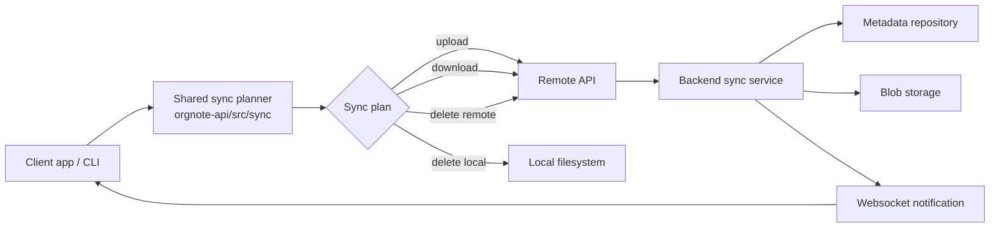
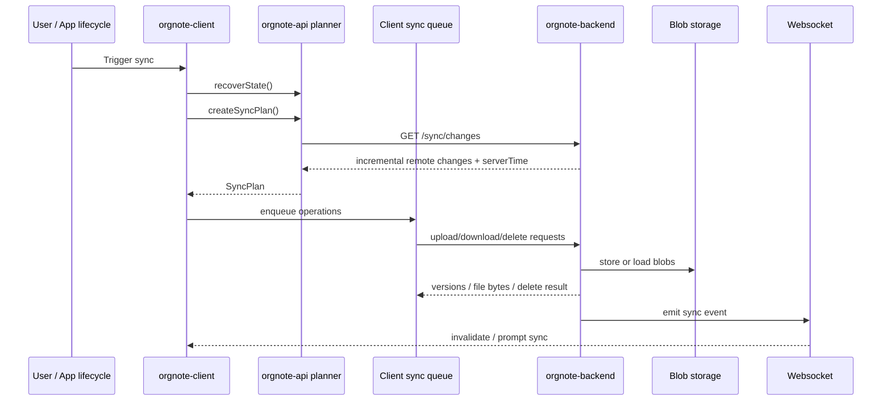
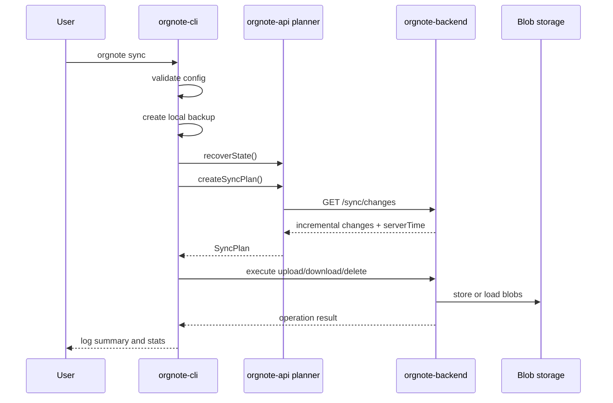
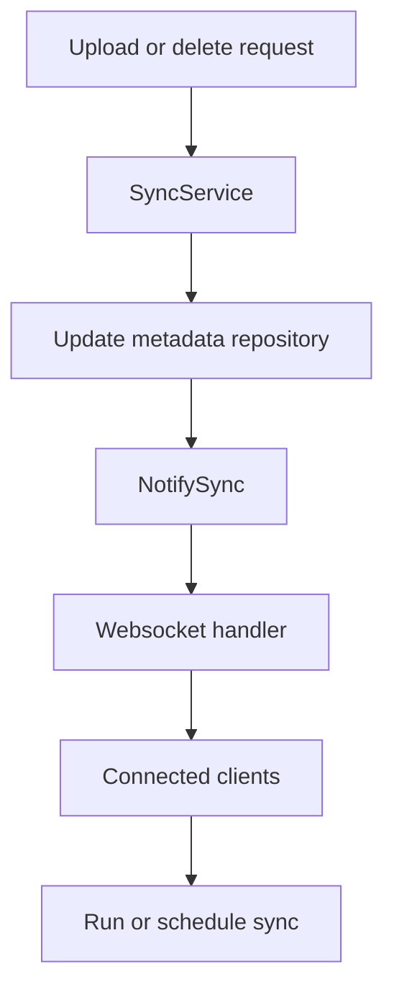
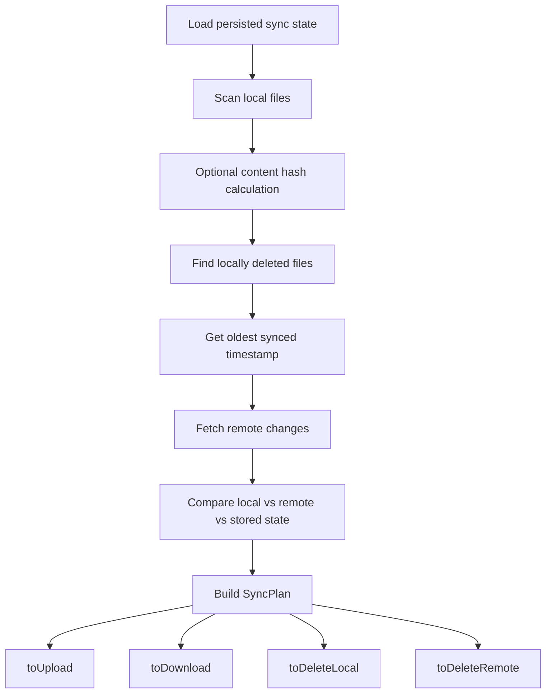
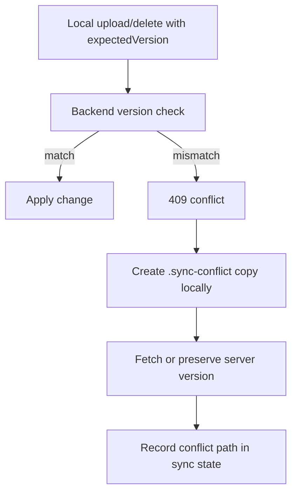

# File synchronization

## Purpose

This document describes the current synchronization mechanism used by OrgNote across:

- `orgnote-client`
- `orgnote-api`
- `orgnote-backend`
- `orgnote-cli`

It documents the implementation as it exists today. The goal is to make the current behavior easy to understand, debug, and evolve.

## Scope

This document covers:

- sync triggers in the client and CLI
- shared sync planning in `orgnote-api`
- queueing and persistence on the client
- upload, download, delete, and conflict behavior
- backend sync endpoints, metadata, blob storage, and websocket invalidation
- local sync state and version tracking
- the current code map with file and line references

This document does **not** describe a proposed redesign.

---

## High-level architecture

OrgNote synchronization is built around four cooperating layers:

1. **Trigger layer**
   - The client or CLI decides when a sync should run.
2. **Planning layer**
   - `orgnote-api` compares local files, remote changes, and stored sync state.
   - It produces a sync plan with uploads, downloads, local deletes, and remote deletes.
3. **Execution layer**
   - The client enqueues operations into a persistent queue.
   - The CLI executes the same operations directly.
4. **Server layer**
   - The backend stores file metadata, versions, tombstones, and content-addressed blobs.
   - It also emits websocket notifications after remote changes.

---

## Core concepts

### Sync plan

A sync run produces a plan with four operation groups:

- `toUpload`
- `toDownload`
- `toDeleteLocal`
- `toDeleteRemote`

The shared planner is implemented in:

- `orgnote-api/src/sync/create-sync-plan.ts`
- `orgnote-api/src/sync/plan.ts`

### Sync state

Both the client and CLI persist per-file sync metadata. That state is used to detect:

- local changes
- remote changes
- local deletions
- version conflicts
- prior errors
- conflict copies

### Version-based conflict detection

The backend uses optimistic version checks. Upload and delete operations can send `expectedVersion`. If the server version does not match, the backend returns a conflict response.

### Content-addressed blobs

The backend stores file contents by content hash. Metadata points to blobs. This prevents re-uploading identical content when the hash is already known.

### Tombstones

Remote deletions are represented as soft-deleted metadata rows. This allows other clients to observe deletions through incremental change queries.

---

## End-to-end flow

### Standard client flow

### Standard CLI flow

---

## Detailed behavior by repository

## `orgnote-client`

### What the client is responsible for

The client is responsible for:

- deciding when sync should run
- preventing sync when the environment is not valid
- building a sync plan through `orgnote-api`
- converting the plan into persistent queue tasks
- executing queue items one at a time
- preserving queue state across restarts
- exposing sync controls in the UI

### Main sync store

The main client entry point is `orgnote-client/src/stores/sync.ts`.

Current behavior:

1. `sync()` first checks whether synchronization is prohibited.
2. It recovers persisted sync state.
3. It calls `createSyncPlan()` from `orgnote-api`.
4. If the plan is not empty, it enqueues plan operations.

Key details:

- sync is blocked when the user is inactive
- sync is blocked when `config.synchronization.type === 'none'`
- sync is blocked after an HTTP `426 Upgrade Required` compatibility error
- content hash checking is enabled during planning

### Client triggers

The client can start sync from several paths:

- manual command
- filesystem bridge events
- app activation or resume
- post-activation flow
- remote config bootstrap

This means the system mixes:

- explicit user-triggered sync
- lifecycle-triggered sync
- file-change-triggered sync
- configuration bootstrap through the same remote sync API

### Queue-based execution

The client does not execute the sync plan immediately inside the store. It converts the plan into queue tasks and persists them.

Important properties of the registered sync queue:

- `concurrent: 1`
- `maxRetries: 2`
- `retryDelay: 1000`
- `deduplicationStrategy: 'replace'`

This keeps execution serialized and makes restart recovery possible.

### Persistent queue storage

Queue persistence is implemented with Dexie-backed storage and repository abstractions.

The queue stores:

- task identity
- payload
- status
- retry count
- locking state
- timestamps

This allows the app to:

- survive restarts
- resume pending sync work
- inspect failed tasks
- serialize sync activity cleanly

### Sync settings and exported profile

The client exposes sync settings through a dedicated UI container. It also supports exporting a local sync profile built from:

- app configuration
- the first API token
- current server-derived endpoints

This exported profile is intended for CLI/bootstrap usage.

### Remote config bootstrap

The client uses the same sync API to fetch `config.toml` during bootstrap. That flow only applies the remote configuration when the local file still matches the default config content.

This is an important special case:

- it is sync-related
- it uses the sync transport
- but it synchronizes configuration instead of note content

---

## `orgnote-api`

### What `orgnote-api` is responsible for

`orgnote-api` contains the shared synchronization engine used by both the client and CLI.

It is responsible for:

- scanning local files
- loading persisted sync state
- computing optional content hashes
- detecting local deletions
- fetching remote changes
- producing a deterministic sync plan
- providing shared upload/download/delete/conflict operations
- exposing generated sync API bindings

### Sync plan creation

The orchestration entry point is `orgnote-api/src/sync/create-sync-plan.ts`.

The current sequence is:

1. load stored sync state
2. scan local files
3. optionally hash local file contents
4. detect files deleted locally
5. calculate the oldest synced timestamp
6. fetch remote changes since that point
7. build the final sync plan

This design keeps planning independent from the client and CLI runtime.

### Decision engine

The core decision logic lives in `orgnote-api/src/sync/plan.ts`.

It compares three data sources:

- local files
- remote files
- stored sync state

From that comparison it decides:

- upload local file
- download remote file
- delete local file
- delete remote file
- do nothing

Important rules from the current implementation:

- if a local file changed and the remote copy is missing, upload it
- if the remote file is marked deleted and the local file did not change, delete it locally
- if both local and remote changed, the current planner still resolves to upload
- if a local deletion is observed and the remote file is unchanged, delete it remotely
- if a local deletion is observed but the remote file changed, download the remote file back locally
- new remote files that do not exist locally are downloaded

### Conflict handling

Conflict behavior is implemented in `orgnote-api/src/sync/operations/conflict.ts`.

When a version conflict is detected:

1. the local file is copied to a generated conflict path
2. the path includes a timestamp and device identity
3. the implementation attempts to fetch the server version
4. sync state stores the conflict copy path

This preserves local user data before overwriting with the server version.

### Shared operation helpers

`orgnote-api/src/sync/operations/*` contains shared helpers for:

- upload
- download
- delete local
- delete remote
- synced-file state transitions
- conflict handling

These helpers update sync state during execution so the planner can make correct decisions on the next run.

### Generated remote API

The generated API client in `orgnote-api/src/remote-api/api.ts` exposes the sync HTTP surface used by the client and CLI.

Important sync parameters include:

- `since`
- `limit`
- `cursor`
- `X-Content-Hash`
- `expectedVersion`

### Shared models

`orgnote-api` also defines the shared sync contracts:

- sync state store contract
- queue store contract
- queue task contract
- sync profile schema
- command identifiers and i18n keys

### Adjacent legacy utility path

There is also an older note-diff utility path in:

- `orgnote-api/src/models/sync.ts`
- `orgnote-api/src/utils/find-notes-files-diff.ts`

These files are sync-adjacent, but they are separate from the current `src/sync/*` planning pipeline. They should be treated as related historical utilities, not the primary active architecture.

---

## `orgnote-backend`

### What the backend is responsible for

The backend is the source of truth for:

- remote file metadata
- file versions
- remote tombstones
- blob storage references
- incremental change feeds
- conflict detection
- storage quota enforcement
- websocket sync notifications

### HTTP endpoints

The backend sync API currently exposes:

- `GET /sync/changes`
- `PUT /sync/files`
- `GET /sync/files`
- `DELETE /sync/files`

These endpoints are registered by the sync handler and wired from `main.go`.

### Incremental remote changes

`GET /sync/changes` returns remote file changes since a timestamp and cursor. The backend uses:

- `updatedAt`
- `_id`
- pagination cursor

This allows deterministic incremental polling.

### Upload behavior

Upload flow on the server:

1. normalize file path
2. enforce maximum file size
3. compute content hash
4. verify the client-provided hash if present
5. enforce user storage quota
6. upload blob only if the hash is not already referenced
7. upsert metadata with optimistic version checking
8. emit a websocket sync notification

### Download behavior

Download flow on the server:

1. normalize file path
2. resolve metadata by path
3. reject deleted entries
4. load the blob by content hash
5. return bytes with metadata-derived version information

### Delete behavior

Delete flow on the server:

1. normalize file path
2. soft-delete the metadata row
3. enforce expected version if provided
4. emit a websocket sync notification

Deletes are represented as tombstones rather than immediate hard deletes.

### Metadata repository

The metadata repository is the most important backend sync component.

It is responsible for:

- querying changes incrementally
- tracking `version`
- enforcing optimistic locking
- soft deletion
- tombstone retention cleanup
- referenced-hash lookup for garbage collection
- total usage calculation for quota checks

### Blob storage

Blob storage is content-hash keyed.

Current shape:

- interface defined in `infrastructure/storage.go`
- implementation in `infrastructure/s3_storage.go`
- path format is `<user>/<contentHash>`

This means metadata and blob storage are intentionally separated.

### Websocket invalidation

The backend emits a `sync` event after upload and delete operations. The websocket handler fans this event out to connected clients and can exclude the originating socket.

This is not a full state replication channel.

It is an **invalidation signal** that tells clients they should refresh or re-run sync logic.

---

## `orgnote-cli`

### What the CLI is responsible for

The CLI provides a non-UI synchronization flow for local folders.

It is responsible for:

- reading published sync configuration
- validating required config values
- making a local backup before sync
- constructing a local filesystem adapter
- constructing persistent sync state
- creating a shared sync plan through `orgnote-api`
- executing the plan directly
- reporting operation and summary logs

### Command flow

The CLI entry point exposes `sync` and `validate-config`.

The `sync` command path:

1. validates configuration
2. creates a backup of the root folder
3. initializes API, filesystem, and sync state dependencies
4. recovers state
5. builds a sync plan
6. logs summary and per-item details
7. executes uploads, downloads, local deletes, and remote deletes
8. prints final stats

### Persistent sync state

The CLI stores per-account sync state under the local config directory. This gives the CLI the same kind of memory the app uses for planning.

### SDK wrapper

The CLI SDK wraps the generated sync API for:

- multipart upload
- remote download
- remote delete
- bearer-token authentication

### Backup strategy

The CLI creates a zip backup of the entire notes directory before sync and trims older backups according to the configured retention count.

This is a protective measure that the interactive client sync queue does not implement the same way.

---

## Planning algorithm in detail

The planner is the center of the current architecture.

### Inputs

The planner needs:

- local filesystem snapshot
- stored sync state
- remote change list
- server time

### Local file change detection

A local file is treated as changed when:

- there is no stored state
- stored status is `error`
- content hash differs when both hashes are known
- otherwise file modification time differs

### Remote file change detection

A remote file is treated as changed when:

- there is no stored state
- remote `version` is greater than stored `version`

### Local deletions

Local deletions are inferred by comparing the current local snapshot to stored sync state.

### New remote files

Remote files that are not in the local snapshot and are not tracked as deleted locally are downloaded.

---

## Execution model

## Client execution model

The client transforms the plan into queue tasks. That queue is durable and processed serially.

Benefits of the current approach:

- fewer overlapping sync writes
- restart-safe execution
- retriable task processing
- better UI-level observability of progress and failures

Tradeoffs:

- more moving parts than direct execution
- queue persistence must remain healthy
- stale queued items can delay fresh work if not managed carefully

## CLI execution model

The CLI executes the same shared operations directly in process.

Benefits:

- simpler runtime model
- easier debugging from logs
- fewer infrastructure dependencies than the app queue

Tradeoffs:

- no durable task queue
- long sync runs live entirely in the command process

---

## Conflict handling

The backend detects write conflicts through optimistic version checks.

Conflict path:

1. client or CLI sends an upload or delete request with `expectedVersion`
2. backend compares that version to the latest metadata version
3. backend returns a `409` conflict response with the server version
4. shared conflict handling creates a local conflict copy
5. the implementation fetches or retries against the server version
6. sync state records the conflict artifact

Important current behavior:

- conflicts are handled as a recovery path, not an interactive merge flow
- the user’s local content is preserved under a generated conflict filename
- server versioning is authoritative for write acceptance

---

## Real-time behavior

OrgNote currently combines:

- **poll-based incremental sync planning** via `GET /sync/changes`
- **push-based invalidation** via websocket `sync` events

This means websocket messages do not carry the full file state. They act as a trigger to refresh sync logic.

This is a good separation of concerns:

- polling remains the source of ordered change data
- websocket remains a lightweight nudge channel

---

## Local persistence and recovery

Both client and CLI persist sync state. The client additionally persists queue state.

### Client persistence

The client persists:

- sync state in the sync store
- queue state in Dexie-backed queue storage

### CLI persistence

The CLI persists:

- per-account sync state in the local config store
- backups in the configured backup location

### Recovery usage

Recovery matters because planning depends on historical knowledge:

- last known versions
- last known modification times or hashes
- previously synced files
- prior errors and conflicts
- deleted entries

Without recovery, the planner would lose enough historical context to make safe decisions.

---

## Special cases and edge behavior

### Version incompatibility gate in the client

If the client receives HTTP `426 Upgrade Required`, it marks the sync environment as version-incompatible and stops future sync attempts.

### Sync disabled by configuration

If `config.synchronization.type === 'none'`, the client refuses to start sync.

### Hash verification

The backend verifies `X-Content-Hash` when the client sends it. The server also computes its own content hash.

### Quota and file size limits

The backend rejects uploads when:

- the file is larger than the configured maximum
- the user has no storage quota
- the upload would exceed the storage quota

### Tombstone cleanup and blob garbage collection

The backend eventually cleans old tombstones and garbage-collects unreferenced blobs that are old enough.

---

## Current strengths of the implementation

The current design has several strong properties:

- shared planning logic between app and CLI
- deterministic plan assembly from local, remote, and stored state
- optimistic version protection for concurrent writes
- content-addressed blob storage
- tombstone-based deletion propagation
- durable queue execution in the client
- websocket invalidation without overloading the transport
- pre-sync backup protection in the CLI

---

## Current caveats and documentation notes

### Remote config sync is a separate concern

The bootstrap of `config.toml` uses the same sync API but is conceptually different from note synchronization. It should be treated as a sync-adjacent configuration bootstrap flow.

### Legacy diff utilities exist

There is an older sync-adjacent note diff utility path in `orgnote-api`. It is relevant historically, but it is not the main current planner pipeline.

### Backend docs tree ambiguity

There are generated sync endpoint docs in `app/docs/docs.go`, and there appears to be a sibling docs tree with matching endpoint definitions. The canonical source of truth was not fully established during this analysis.

---

## Troubleshooting checklist

When synchronization behaves incorrectly, inspect in this order:

1. **Trigger path**
   - Was sync actually triggered by the client or CLI?
2. **Client gatekeeping**
   - Is sync disabled by config, auth inactivity, or version incompatibility?
3. **Recovered state**
   - Is stored sync state corrupted, stale, or missing?
4. **Plan generation**
   - Did `createSyncPlan()` produce the expected uploads/downloads/deletes?
5. **Queue state**
   - For the client, were tasks enqueued and persisted correctly?
6. **Backend version conflicts**
   - Did the server reject a write with `409`?
7. **Blob storage**
   - Was content stored or loaded successfully by content hash?
8. **Websocket invalidation**
   - Were sync events emitted after remote changes?

---

## Code map: all synchronization-related references

This appendix is the implementation index for the current sync mechanism.

## `orgnote-client`

### Main store and orchestration

- `orgnote-client/src/stores/sync.ts:1-111`
- `orgnote-client/src/composables/use-auto-sync.ts:1-45`
- `orgnote-client/src/composables/post-activation-sync.ts:1-8`
- `orgnote-client/src/composables/bootstrap-remote-config.ts:1-135`
- `orgnote-client/src/boot/auth.ts:1-27`
- `orgnote-client/src/boot/fs-sync-bridge.ts:1-41`
- `orgnote-client/src/boot/default-queues.ts:1-78`
- `orgnote-client/src/boot/repositories.ts:1-23`
- `orgnote-client/src/boot/api.ts:88-116`

### Sync infrastructure

- `orgnote-client/src/infrastructure/sync/index.ts:1-8`
- `orgnote-client/src/infrastructure/sync/sync-executor.ts:1-61`
- `orgnote-client/src/infrastructure/sync/sync-processor.ts:1-50`
- `orgnote-client/src/infrastructure/sync/sync-task-factory.ts:1-51`

### Queue infrastructure

- `orgnote-client/src/stores/queue.ts:1-336`
- `orgnote-client/src/infrastructure/repositories/queue-repository.ts:1-165`
- `orgnote-client/src/infrastructure/stores/queue-store.ts:1-159`

### Commands and UI

- `orgnote-client/src/commands/global-commands.ts:268-288`
- `orgnote-client/src/commands/settings-commands.ts:239-266`
- `orgnote-client/src/commands/developer-commands.ts:1-123`
- `orgnote-client/src/commands/settings-commands.spec.ts:156-190`
- `orgnote-client/src/containers/SynchronisationSettings.vue:1-68`

### Config and helpers

- `orgnote-client/src/utils/sync-state.ts:1-26`
- `orgnote-client/src/utils/server-endpoints.ts:1-51`
- `orgnote-client/src/utils/server-endpoints.spec.ts:11-35`
- `orgnote-client/src/utils/local-sync-profile-config.ts:1-37`
- `orgnote-client/src/constants/config.ts:16-45`

---

## `orgnote-api`

### Core sync planner

- `orgnote-api/src/sync/create-sync-plan.ts:1-57`
- `orgnote-api/src/sync/plan.ts:1-191`
- `orgnote-api/src/sync/scan.ts:1-71`
- `orgnote-api/src/sync/fetch.ts:1-63`
- `orgnote-api/src/sync/types.ts:1-113`
- `orgnote-api/src/sync/utils/oldest-synced-at.ts:1-12`
- `orgnote-api/src/sync/utils/content-hash.ts:1-7`

### Sync operations

- `orgnote-api/src/sync/operations/upload.ts:1-52`
- `orgnote-api/src/sync/operations/download.ts:1-88`
- `orgnote-api/src/sync/operations/delete-local.ts:1-18`
- `orgnote-api/src/sync/operations/delete-remote.ts:1-29`
- `orgnote-api/src/sync/operations/conflict.ts:1-98`
- `orgnote-api/src/sync/operations/synced-file.ts:1-25`

### Shared models and command surface

- `orgnote-api/src/models/sync-store.ts:1-14`
- `orgnote-api/src/models/queue-store.ts:1-61`
- `orgnote-api/src/models/queue-task.ts:1-19`
- `orgnote-api/src/models/sync-profile-config.ts:1-31`
- `orgnote-api/src/models/default-commands.ts:79-81`
- `orgnote-api/src/models/default-commands.ts:134-139`
- `orgnote-api/src/constants/i18n-keys.ts:22-28`
- `orgnote-api/src/constants/i18n-keys.ts:47-48`

### Generated API bindings

- `orgnote-api/src/remote-api/api.ts:31-79`
- `orgnote-api/src/remote-api/api.ts:525-553`
- `orgnote-api/src/remote-api/api.ts:1340-1699`

### Tests

- `orgnote-api/src/sync/__tests__/*`

### Adjacent legacy utilities

- `orgnote-api/src/models/sync.ts:1-36`
- `orgnote-api/src/utils/find-notes-files-diff.ts:1-189`
- `orgnote-api/src/utils/__tests__/find-files-diff.spec.ts:1-176`
- `orgnote-api/src/utils/__tests__/read-org-files-recursively.spec.ts:1-61`
- `orgnote-api/src/utils/__tests__/find-note-files-diff.spec.ts:1-209`

---

## `orgnote-backend`

### HTTP handlers and routing

- `orgnote-backend/app/handlers/sync_handler.go:1-352`
- `orgnote-backend/app/main.go:123-155`

### Services

- `orgnote-backend/app/services/sync_service.go:1-285`
- `orgnote-backend/app/services/notification_service.go:1-37`
- `orgnote-backend/app/services/errors.go:1-23`

### Repositories and models

- `orgnote-backend/app/repositories/file_metadata_repository.go:1-505`
- `orgnote-backend/app/models/file_metadata.go:1-65`

### Storage and path utilities

- `orgnote-backend/app/infrastructure/storage.go:1-37`
- `orgnote-backend/app/infrastructure/s3_storage.go:1-197`
- `orgnote-backend/app/tools/normalize_path.go:1-7`
- `orgnote-backend/app/tools/normalize_path_test.go:1-31`

### Websocket invalidation

- `orgnote-backend/app/handlers/websocket_handler.go:1-182`

### Generated docs

- `orgnote-backend/app/docs/docs.go:355-603`
- `orgnote-backend/app/docs/docs.go:784-902`

### Backend tests

- `orgnote-backend/app/*/*_test.go`

---

## `orgnote-cli`

### Entry points and command wiring

- `orgnote-cli/src/cli.ts:1-40`
- `orgnote-cli/src/index.ts:1-93`
- `orgnote-cli/src/commands/command-handlers.ts:1-55`
- `orgnote-cli/src/commands/sync.ts:1-348`

### Local state and filesystem

- `orgnote-cli/src/adapters/sync-state.ts:1-40`
- `orgnote-cli/src/adapters/node-file-system.ts:1-114`
- `orgnote-cli/src/store/store.ts:1-73`

### Config and API wrapper

- `orgnote-cli/src/config.ts:1-193`
- `orgnote-cli/src/commands/sdk.ts:1-163`

### Backup and tests

- `orgnote-cli/src/backup.ts:1-74`
- `orgnote-cli/src/config.spec.ts:1-72`

---

## Recommended next documentation additions

If this sync system will continue evolving, the next useful documents would be:

1. `docs/file-synchronization-troubleshooting.md`
2. `docs/file-synchronization-conflicts.md`
3. `docs/file-synchronization-api.md`
4. `docs/file-synchronization-state-model.md`

These can be generated directly from the code map above.
